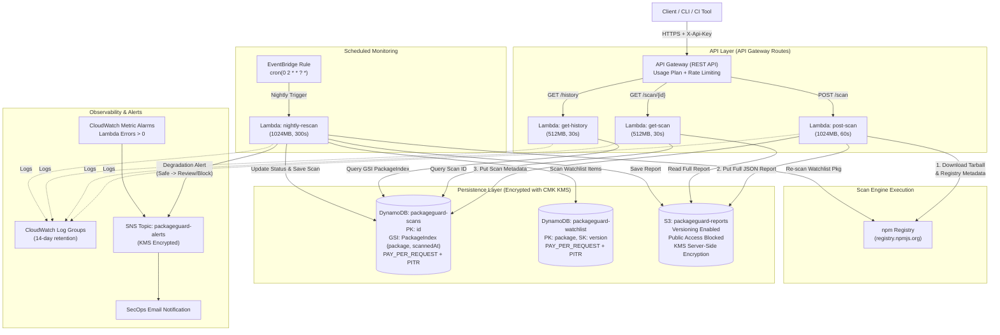

# PackageGuard AWS Serverless Architecture & Deployment Guide

## 1. Architecture Overview

PackageGuard's AWS backend is designed around serverless and pay-per-request services. It implements pre-install npm package risk analysis, cryptographic verification, static AST heuristics, report storage, and scheduled watchlist monitoring with zero compute charges when idle.



---

## 2. Request Flow & Execution Model

1. **`POST /scan` (Package Analysis Pipeline)**:
   - Validates package name against npm naming specifications and version string format against semver. Enforces a 32 KB request body cap.
   - Invokes `scanFromRegistry` in `@packageguard/core`:
     - Fetches metadata from registry (`https://registry.npmjs.org/<package>`).
     - Downloads tarball bytes in memory for target version and previous version.
     - Runs 6 scanners in parallel: Metadata, OSV Vulnerabilities, Cryptographic Integrity (SHA-512 + ECDSA signatures + Sigstore provenance), Typosquatting, Static AST Analyzer, and Version Diff.
     - Deduplicates findings and passes them to Risk & Policy engines.
   - Stores the complete JSON report in S3 under `reports/<package>/<version>/<scanId>.json`.
   - Records metadata, scores, verdict, verification status, and timestamp in DynamoDB (`packageguard-scans`).
   - Responds with `201 Created` including `scanId` and the evaluated report.

2. **`GET /scan/{id}` (Scan Fetch)**:
   - Validates UUID scan identifier.
   - Reads scan record from `packageguard-scans` DynamoDB table.
   - Fetches full report JSON from S3 and returns combined record.

3. **`GET /history?package=<name>` (Audit Trail)**:
   - Validates `package` query parameter.
   - Queries DynamoDB Global Secondary Index `PackageIndex` (`package` HASH, `scannedAt` RANGE) with descending sort order.
   - Returns paginated list of all past verdicts, scores, and dates for that package.

4. **Scheduled Nightly Re-scan**:
   - EventBridge cron trigger (`0 2 * * ? *`) invokes `nightly-rescan` Lambda.
   - Iterates entries in `packageguard-watchlist` DynamoDB table.
   - Re-runs engine scan against the latest registry tarball and OSV database.
   - Detects state transitions: If a package was previously `Safe` and degrades to `Review` or `Block` (e.g. newly published CVE or post-install compromise), it constructs an alert payload and publishes immediately to the KMS-encrypted SNS topic.

---

## 3. Security Controls & Architecture Hardening

- **Zero Untrusted Code Execution**: Lambda runs static AST analysis (`acorn`) on in-memory buffers only. Tarballs and lifecycle scripts are NEVER executed.
- **Customer-Managed Encryption Keys (KMS CMK)**:
  - Automatic annual key rotation enabled.
  - S3 bucket encrypted with KMS SSE (`aws:kms`) and bucket key enabled.
  - DynamoDB tables encrypted with KMS CMK.
  - SNS topic encrypted with KMS CMK.
- **Strict Least-Privilege IAM Roles**:
  - Each Lambda function has a dedicated IAM role with distinct action boundaries:
    - `post-scan`: `s3:PutObject` on reports bucket, `dynamodb:PutItem` on scans table, `kms:GenerateDataKey` and `kms:Decrypt` on customer-managed KMS key.
    - `get-scan`: `dynamodb:GetItem` on scans table, `s3:GetObject` on reports bucket, `kms:Decrypt` on customer-managed KMS key.
    - `get-history`: `dynamodb:Query` on scans table and `PackageIndex` GSI, `kms:Decrypt` on customer-managed KMS key.
    - `nightly-rescan`: `dynamodb:Scan`/`PutItem` on watchlist, `dynamodb:PutItem` on scans, `s3:PutObject` on reports bucket, `sns:Publish` on alerts topic, `kms:GenerateDataKey` and `kms:Decrypt` on customer-managed KMS key.
  - All KMS actions are strictly scoped to the single customer-managed KMS key ARN (no wildcard `*` resources).
  - No wildcard actions (`*`) on data resources.
- **S3 Public Access Block**: All four public access block settings (`block_public_acls`, `block_public_policy`, `ignore_public_acls`, `restrict_public_buckets`) enforced on the reports bucket.
- **S3 Object Versioning**: Enabled to prevent accidental deletion or tampering with historic reports.
- **Point-in-Time Recovery (PITR)**: Enabled on all DynamoDB tables for continuous backups.
- **API Key & Usage Plan Protection**:
  - API Gateway endpoints enforce `api_key_required = true`.
  - Rate limiting (50 req/sec) and burst protection (100 req) prevent denial-of-wallet and upstream abuse.
  - Default monthly quota prevents runaway billing.
- **Log Retention**: CloudWatch Log Groups configure an explicit 14-day retention limit to avoid unbounded log storage costs.

---

## 4. Cost Analysis & Free-Tier Suitability

PackageGuard is architected to remain within the AWS Always-Free Tier or cost negligible amounts at low-to-medium volumes:

| Service | Allocation | Estimated Cost |
|---|---|---|
| **AWS Lambda** | 1M free requests/month & 3.2M seconds compute | **\$0.00** (within free tier) |
| **API Gateway** | 1M free calls/month (first 12 mos) then \$1.00 / 1M | **<\$0.50 / month** |
| **DynamoDB** | On-Demand (pay-per-request). 25 GB free storage. | **<\$0.20 / month** |
| **S3** | 5 GB standard storage in free tier. | **<\$0.10 / month** |
| **KMS** | \$1.00 / month for 1 Customer Managed Key | **\$1.00 / month** |
| **SNS & EventBridge** | 1M free SNS publishes/month, free EventBridge rules | **\$0.00** |
| **Total Estimated Run Cost** | Idle / Low Usage (< 10,000 scans/month) | **~\$1.50 - \$2.00 / month** |

---

## 5. Deployment Guide (Step-by-Step)

Follow these exact steps to build and deploy PackageGuard infrastructure on AWS.

### Prerequisites
- Node.js 20+ and npm installed
- AWS CLI configured (`aws configure` with credentials possessing IAM permissions)
- Terraform CLI >= 1.5.0 installed

### Step 1: Bundle Lambda Handlers into Zip Files
From the project root:
```bash
# Install dependencies across all workspaces
npm install

# Bundle the four Lambda handlers into infra/build/*.zip
npm --workspace=services/api run build
```
Verify that `infra/build/` contains:
- `post-scan.zip`
- `get-scan.zip`
- `get-history.zip`
- `nightly-rescan.zip`

### Step 2: Initialize Terraform
Navigate to the `infra/` directory:
```bash
cd infra
terraform init
```

### Step 3: Plan Infrastructure
Review the planned infrastructure:
```bash
terraform plan -var="alert_email=secops@yourdomain.com" -out=tfplan
```

### Step 4: Apply Infrastructure
Provision the cloud resources:
```bash
terraform apply tfplan
```
Once complete, Terraform outputs the API invoke URL and API key ID:
```text
Outputs:
api_invoke_url = "https://a1b2c3d4e5.execute-api.us-east-1.amazonaws.com/v1"
api_key_id     = "abc123xyz"
```

To extract the secret API key value:
```bash
terraform output -raw api_key_value
```

### Step 5: Test Endpoints with curl

1. **Trigger a package scan (`POST /scan`)**:
   ```bash
   API_URL=$(terraform output -raw api_invoke_url)
   API_KEY=$(terraform output -raw api_key_value)

   curl -X POST "${API_URL}/scan" \
     -H "Content-Type: application/json" \
     -H "X-Api-Key: ${API_KEY}" \
     -d '{"package": "lodash", "version": "4.17.21"}'
   ```
   *Expected response: `201 Created` with `scanId` and `report` JSON.*

2. **Retrieve scan by ID (`GET /scan/{id}`)**:
   ```bash
   curl -X GET "${API_URL}/scan/<scanId-from-above>" \
     -H "X-Api-Key: ${API_KEY}"
   ```

3. **Check package history (`GET /history`)**:
   ```bash
   curl -X GET "${API_URL}/history?package=lodash" \
     -H "X-Api-Key: ${API_KEY}"
   ```

### Step 6: Teardown / Destroy Infrastructure
To remove all provisioned AWS resources and avoid ongoing charges:
```bash
terraform destroy -var="alert_email=secops@yourdomain.com"
```
